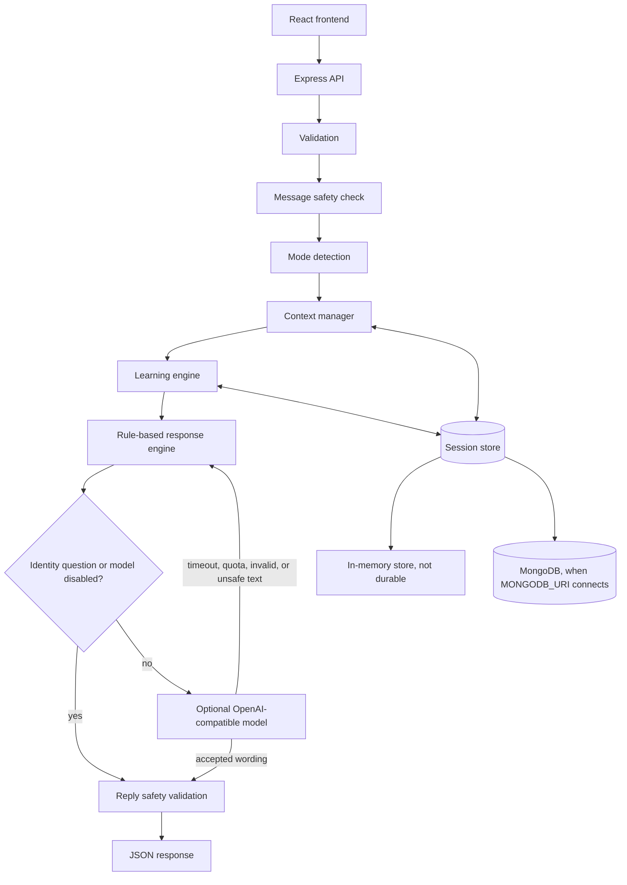

# Architecture

Little English Buddy is one repository with two apps. The React frontend and the Express API talk only over HTTP. The server owns the learning level, score, and current question. The browser stores an anonymous session id in `localStorage`.

## Request path

Grading and level changes happen in the learning engine before any model call. The model may word a reply. It cannot mark an answer correct or change L1, L2, or L3. If the provider times out, has no credits, returns invalid text, or contradicts the grade, the rule-based reply is sent.

Questions such as "Are you OpenAI?" skip the model. The reply always starts with "No" and then says the helper is Little English Buddy.

## Frontend

The Vite app reads `VITE_API_BASE_URL` when it is built or when the dev server starts. On first visit it creates a session id and saves it in `localStorage`. It then calls `GET /api/chat/session/:sessionId`. If that id is new, the API creates an empty session and returns it. The screen shows the returned level, stars, activity, and quick replies.

Sending a message, tapping a mood, tapping a quick reply, or choosing Learn, Game, or Talk calls `POST /api/chat`. The chat history scrolls inside its panel. The typing box stays fixed at the bottom. A failed request shows an error and a retry control. It does not insert a made-up buddy reply.

## Backend

Development runs with nodemon (`npm run dev`), which restarts when `src` or `.env` changes. Production runs `node src/server.js`.

`createApp` adds Helmet, CORS, JSON parsing, request logging, and rate limiting. After Zod validation, one turn does this:

1. Redact phone numbers and email addresses before the text is stored.
2. If the message signals serious distress, pause the lesson and ask the child to tell a trusted grown-up. That turn is not graded.
3. Detect exactly one mode: `LEARNING`, `CONVERSATION`, `ENGAGEMENT`, or `SUPPORT`.
4. Grade a lesson or a guessing game only when the turn is an answer. Chat, feelings, and games do not count as quiz attempts.
5. Keep context bounded: 20 turns, 8 topics, and 30 attempts.
6. Build the rule-based reply. Simple sums and a few everyday facts are answered here.
7. If a model key is set, and the question is not an identity question, ask the model to answer in simple child English.
8. Check the wording, save the session, and return public state. Accepted answers stay on the server.

## Session store

| `MONGODB_URI` | What happens |
| --- | --- |
| Empty | Process memory. Progress ends when the process stops. Health reports `durable: false`. |
| Set and connected | Mongoose `LearningSession` documents. A TTL index removes a session 7 days after its last update. |
| Set but the connection fails | The process still starts. Health reports `degraded`. Chat routes return `503 DATABASE_UNAVAILABLE`. The server does not pretend memory is being used. |

`GET /api/chat/session/:sessionId` creates an empty L1 session when that anonymous id is not stored yet. `DELETE` of an unknown id still returns 404.

## Optional model

`llm.service.js` calls an OpenAI-compatible chat endpoint only when `LLM_PROVIDER` and `LLM_API_KEY` are both set. The key stays on the server. The call uses `LLM_TIMEOUT_MS`, a small token budget, and a system prompt that treats the child message as data. The model must return JSON with `reply` and optional `quickReplies`. While a lesson or game is waiting for an answer, the quick replies stay as the rule-based choices.
